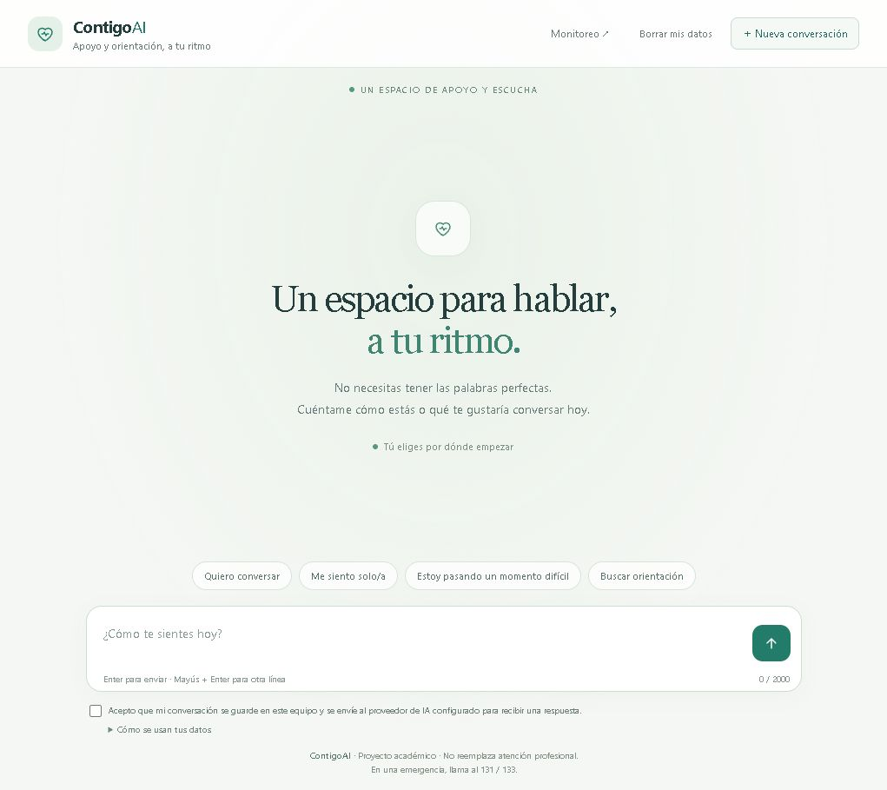

# EP3: funcionamiento, métricas y evidencia

Esta ampliación reutiliza el agente de EP1/EP2. La implementación es un monitor
local con FastAPI, SQLite y una interfaz HTML/JavaScript sin servicios externos.
Las trazas tienen identificadores y spans anidados; no se afirma compatibilidad
con el protocolo de OpenTelemetry ni se requiere una cuenta de Grafana.

## Requisitos y ubicación

| Pauta | Implementación | Evidencia |
|---|---|---|
| IE1: precisión, consistencia, errores | `src/observabilidad.py`, casos etiquetados y repetidos | JSON de evaluación; tarjetas y filtros del dashboard |
| IE2: latencia y recursos | `perf_counter`, `thread_time`, RSS mediante psutil, usage del proveedor | Media, p50/p95, CPU, RSS, tokens y reintentos |
| IE3: registros y puntos de falla | trace_id, span_id, parent_id, duración, estado y tipo de excepción | Detalle de ejecución y timeout controlado |
| IE4: dashboard | `/observabilidad` | Filtros, gráficos, tabla, detalle y exportación CSV/JSON |
| IE5–IE7: evidencia y análisis | `pruebas/evidencia/ep3/`, esta guía y diagrama | Capturas y datos para el informe y la exposición |
| IE8: privacidad y responsabilidad | Registros sin texto, acceso protegido, borrado de memoria, aviso al usuario | Pruebas de acceso, no filtración y eliminación |
| IE9: defensa técnica | Fórmulas, limitaciones y comandos reproducibles | Explicar con los datos del lote elegido |

## Reproducir la evaluación

```powershell
python -m pip install -r requirements.txt
python pruebas/test_ep3.py
python pruebas/run_evidencia_ep3.py --sin-llm --repeticiones 3
python -m uvicorn src.api:app --host 127.0.0.1 --port 8000 --no-access-log
```

En `http://127.0.0.1:8000/observabilidad` selecciona **Evaluación · LLM simulado**.
Luego selecciona **Fallos controlados** y abre la traza de error para localizar
`generar_respuesta → TimeoutError`. Prueba exportar ambos filtros por separado.

Cada lote incluye 12 casos de un turno y una conversación de dos turnos,
repetidos tres veces: 42 invocaciones con etiquetas. Cubren saludos, mayúsculas,
consultas, tildes omitidas, longitud variable, aislamiento, crisis, límites del
agente y continuidad del protocolo. Un timeout adicional comprueba la captura
de fallos y se excluye del grupo de evaluación funcional. Las etiquetas son
explícitas en el runner y deben ser revisadas por el equipo.

El runner crea memoria temporal y un índice TF-IDF separado (`datos/.indice_ep3`).
No lee las conversaciones existentes ni usa sus mensajes como casos de prueba.
Los JSON tienen nombres únicos por lote para conservar la evidencia anterior.
El dashboard acumula los lotes dentro del periodo; el JSON individual permite
analizar una única corrida sin mezclarla con otras.

Para evaluar el LLM configurado, usa `--con-llm`. Solo envía casos sintéticos,
pero consume la cuota del proveedor. La precisión funcional de esta evaluación
no califica empatía, factualidad ni calidad semántica de las respuestas del LLM;
se necesita una rúbrica humana adicional para esas dimensiones.

## Definiciones operativas

| Métrica | Cálculo y alcance |
|---|---|
| Precisión funcional (acierto conjunto) | Casos que cumplen intención, nivel, protocolo y herramientas requeridas / casos etiquetados × 100. Los errores técnicos etiquetados cuentan como desaciertos. No es precision de una clase ni exactitud clínica. |
| Consistencia de decisiones | Pares de repeticiones del mismo caso y lote con igual intención, riesgo, protocolo y herramientas / todos los pares comparables × 100. Excluye ejecuciones fallidas y no compara el texto generado. Puede ser 100 % aunque exista un error sistemático. |
| Tasa de error | Invocaciones que terminan con excepción / invocaciones × 100. No incluye rechazos HTTP 422 anteriores a invocar el agente ni reintentos recuperados. |
| Latencia | Tiempo de pared de la invocación, incluidos memoria, herramientas y LLM, antes de persistir su propia telemetría. No incluye transporte HTTP al navegador. p95 usa interpolación lineal. |
| CPU del hilo | Diferencia de `thread_time()` en el hilo invocador. No equivale a CPU total ni incluye trabajo de todos los hilos de bibliotecas. |
| RSS | Memoria residente del proceso al inicio y al final. Se muestra la media del valor final; no es pico ni memoria exclusiva de una solicitud. |
| Tokens | Valores `usage` reportados por proveedor compatible, o contadores de Ollama. Si no se informan, quedan en `null`; no se estiman a partir de caracteres. |
| Reintentos | Nuevos intentos HTTP tras respuestas transitorias, con spans de espera. Se distingue una respuesta recuperada de una invocación fallida. |

Sin datos o sin denominador, la métrica devuelve `null` y se muestra «—».
Los tiempos de spans anidados se superponen: no deben sumarse como etapas
independientes. La tabla muestra 100 trazas, y resumen/exportación como máximo
5.000 dentro del filtro; el panel advierte si se alcanza ese límite.

## Evidencia obtenida en este equipo

Lote `20261123T234835Z-571a5d`, ejecutado el 23 de noviembre de 2026:

| Resultado | Valor observado |
|---|---|
| Modo | LLM simulado; grafo, RAG TF-IDF y memoria reales |
| Casos etiquetados | 42 |
| Casos que cumplieron todas las etiquetas | 36 |
| Precisión funcional | 85,71 % |
| Consistencia | 100 % en 42 pares |
| Errores de ejecución del grupo de evaluación | 0 |
| Fallos controlados, grupo aparte | 1 TimeoutError |
| Latencia media / p95 | 27,218 ms / 34,116 ms |
| CPU media del hilo | 17,857 ms |
| RSS final medio del proceso | 180,094 MB |

Los tiempos son de esta corrida y no representan la latencia de un LLM remoto.
Dos casos fallan en sus tres repeticiones: `informacion_sin_tilde` y
`panico_sin_tilde`. El clasificador existente compara frases con tildes y devuelve
`apoyo` en esas variantes. Se preservó ese comportamiento para dejar visible el
hallazgo, sin modificar las etiquetas para mejorar artificialmente la nota.

El span de mayor duración media es `guardar_memoria` en esta corrida. Ese dato
permite estudiar las escrituras y los embeddings, pero con un LLM real el orden
de los tiempos puede cambiar. La traza del fallo controlado localiza el timeout
en `generar_respuesta`; no contiene el mensaje ni la excepción completa.

## Experimentos que el equipo puede justificar con los datos

| Evidencia | Cambio a evaluar | Cómo comprobarlo |
|---|---|---|
| 6 desaciertos en variantes sin tilde | Normalización de tildes en texto y reglas | Repetir el mismo conjunto; añadir negaciones, errores de escritura y casos nuevos antes de concluir que generaliza. |
| Escrituras de memoria dominan esta corrida simulada | Agrupar escrituras o revisar frecuencia de notas | Comparar p95 y CPU con la misma carga, conservando continuidad y recuperación. |
| Timeout controlado en generación | Presupuesto total de tiempo, reintentos limitados y una respuesta de contingencia revisada | Inyectar tiempos de espera y respuestas transitorias; medir latencia y errores antes/después. |
| SQLite local y límite de 5.000 registros por consulta | Para mayor carga, agregación incremental y un almacén centralizado de trazas | Medir concurrencia, cola y pérdidas de registro; no inferir escalabilidad solo de 42 casos. |

Estas son propuestas de experimentos. Las conclusiones y justificaciones
académicas deben desarrollarse y validarse con el equipo.

## Privacidad, seguridad y limitaciones

- La telemetría guarda solo metadatos operativos. No guarda prompts, respuestas,
  notas, claves, URLs del proveedor ni session_id. La correlación es por trace_id.
- Las excepciones públicas y los registros omiten textos de error del proveedor.
- El monitor usa `ContextVar` para aislar invocaciones concurrentes y SQLite WAL.
  Si su almacenamiento falla, el chat puede continuar y marca `registrada=false`.
- Las trazas se guardan al terminar la invocación. Una terminación abrupta del
  proceso puede perder la traza en curso; no es un colector distribuido durable.
- Retención predeterminada: 30 días, configurable. La limpieza ocurre al guardar
  nuevas trazas; un servicio inactivo requiere mantenimiento si se exige borrado
  por plazo estricto. El borrado lógico SQLite no garantiza borrado forense.
- La memoria conversacional sí conserva texto y es sensible aunque use sesiones
  seudónimas. El chat informa esto y ofrece borrado de la sesión actual. El aviso
  de aceptación se implementa en la interfaz; no constituye control legal de
  consentimiento para clientes que llamen directamente a la API.
- Sin `CONTIGOAI_OBS_TOKEN`, el acceso al monitor y a la memoria se restringe a
  conexiones loopback. Con token se exige `X-Observabilidad-Token`, comparado en
  tiempo constante. No poner el token en la URL ni compartirlo en capturas.
- Uso previsto: demo local académica. No publicar detrás de un proxy sin añadir
  autenticación de usuarios, autorización por sesión, HTTPS, límites de uso y
  revisión de tratamiento de datos con el proveedor. No se declara cumplimiento
  normativo ni aptitud para atención clínica.
- Se corrigió el canal erróneo de la línea de ayuda en código y corpus. Ejecutar
  `python src/ingesta.py` para reconstruir el índice con el texto corregido.
- TF-IDF es el respaldo léxico para pruebas sin red; no ofrece la misma memoria
  semántica que FastEmbed. Las pruebas EP2 se verificaron con el modelo FastEmbed
  y un LLM simulado. No cambiar el modelo de una memoria ya poblada sin migrarla.

## Pruebas realizadas

- `python pruebas/test_ep3.py`: 18/18, incluyendo fórmulas, concurrencia,
  persistencia de fallos, privacidad, retención, acceso, exportación y continuidad.
- `python pruebas/test_ep2.py`: 6/6 con FastEmbed y LLM simulado.
- `python pruebas/test_pipeline.py`: 6/6 escenarios y recuperación RAG con TF-IDF.
- Revisión visual del dashboard: filtros, estados vacíos, detalle del fallo y
  capturas. La prueba no utilizó conversaciones reales ni llamó al LLM remoto.

## Preparar el informe y la presentación

El PDF de evaluación pide un informe Word/PDF de hasta cinco páginas, repositorio
con README y evidencia, y exposición de diez minutos más preguntas. El código
y esta guía no sustituyen esos entregables. Una distribución posible del informe:

1. Objetivo, arquitectura y alcance de la ampliación.
2. Métricas, fórmulas y diseño de los casos de evaluación.
3. Dashboard y capturas, indicando modo y lote.
4. Hallazgos y propuestas justificadas por el equipo con datos observados.
5. Privacidad, limitaciones, referencias y reflexiones personales.

Completar integrantes, enlace del repositorio, conclusiones y reflexiones propias.
Declarar el uso de Codex para apoyar implementación, pruebas y documentación;
revisar cada contenido antes de entregarlo. La pauta pide que las reflexiones y
justificaciones evaluadas sean elaboradas por los estudiantes. No se publicaron
archivos ni se enviaron mensajes al docente como parte de esta implementación.

## Referencias técnicas (formato APA)

OpenTelemetry. (s. f.). *Traces*. https://opentelemetry.io/docs/concepts/signals/traces/

FastAPI. (s. f.). *HTTP Basic Auth*. https://fastapi.tiangolo.com/advanced/security/http-basic-auth/
Referencia para comparación de secretos; aquí se usa un header propio, no HTTP Basic.

Python Software Foundation. (s. f.). *time — Time access and conversions*.
https://docs.python.org/3/library/time.html

psutil. (s. f.). *Documentation*. https://psutil.readthedocs.io/

Ministerio de Salud de Chile. (s. f.). *Línea de atención *4141, no estás solo, no estás sola*.
https://www.minsal.cl/linea-de-atencion-4141-no-estas-solo-no-estas-sola/


## Actualización: evaluación con LLM real

Se ejecutó el lote `20261124T002134Z-7f3f1c` con Groq y el modelo configurado
`openai/gpt-oss-120b`. Se usaron casos sintéticos, RAG TF-IDF y memoria temporal.

| Métrica | Resultado |
|---|---|
| Invocaciones reales completadas | 42/42 |
| Acierto funcional | 36/42 (85.71 %) |
| Consistencia de decisiones | 100.0 % |
| Latencia media / p95 | 9.54 s / 18.39 s |
| Reintentos HTTP | 108 |
| Tokens de entrada / salida reportados | 53698 / 14245 |

Las 42 invocaciones finalizaron sin error técnico, pero hubo 108 reintentos
ante respuestas HTTP transitorias. Los registros actuales no guardan el código
HTTP concreto, por lo que no permiten atribuirlos exclusivamente a límites de
cuota o a fallos del proveedor. Los tiempos incluyen las esperas de reintento.

Permanecen seis desaciertos funcionales: los casos `informacion_sin_tilde` y
`panico_sin_tilde` fallan en sus tres repeticiones. El 100 % de consistencia
significa que se repiten las decisiones, incluso cuando son incorrectas.
No se calificó la calidad clínica ni semántica del texto generado.

Evidencia: [JSON del lote real](../pruebas/evidencia/ep3/20261124T002134Z-7f3f1c.json)
y [resumen de pruebas](../pruebas/evidencia/ep3/resumen_20261124T002134Z-7f3f1c.txt).
También se volvieron a aprobar 18 pruebas EP3, 6 EP2 y los 6 escenarios del
pipeline más la comprobación RAG.

## Interfaz del chat

El chat incorpora una bienvenida, tonos verdes, mensajes diferenciados,
escritura de varias líneas y contador de caracteres. Las sugerencias completan
el campo para revisarlo antes del envío. Enter envía y Mayús + Enter añade una línea.


